# POP: como usar o RotaFibra

Procedimentos operacionais padrão (POP) do app **RotaFibra**, para o técnico de campo e para o administrador e o escritório. Cada procedimento diz quem faz, o que precisa ter antes, o passo a passo (com a tela de exemplo), como conferir que deu certo e o que fazer se der errado.

> As telas são de exemplo (dados e nomes inventados). Há também o passo a passo interativo, no próprio app: **Ajustes › Como usar**.

Versão de 17/10/2026. Gerado a partir de `public/demo/conteudo.js` (o mesmo texto do “Como usar”); para atualizar, veja [README](README.md).

## Sumário

**Técnico de campo**

- [POP-01 · Instalar e entrar](#pop-01)
- [POP-02 · Começar e concluir uma atividade](#pop-02)
- [POP-03 · Marcar poste, CTO, CEO e ocorrência](#pop-03)
- [POP-04 · Lançar cabo poste a poste, com ramais](#pop-04)
- [POP-05 · Fibras, ligações e rota acesa](#pop-05)
- [POP-06 · Projeto que o administrador entregou](#pop-06)
- [POP-07 · Trilha GPS e camadas de referência](#pop-07)
- [POP-08 · Sem internet e sincronização](#pop-08)
- [POP-09 · Backup e exportar](#pop-09)
- [POP-10 · Ajustes: Como usar, tema e conta](#pop-10)

**Administrador e escritório**

- [POP-11 · Aprovar pessoas (administrador)](#pop-11)
- [POP-12 · Criar e entregar um projeto (administrador)](#pop-12)
- [POP-13 · Desenhar o projeto no mapa (administrador)](#pop-13)
- [POP-14 · Painel do escritório: mapa da rede](#pop-14)
- [POP-15 · Painel: atividades, projetos e totais](#pop-15)
- [POP-16 · Corrigir, acompanhar e excluir (administrador)](#pop-16)

---

# Técnico de campo

No celular, no campo: marcar, lançar cabo, fibras e uso sem internet.

## POP-01 · Instalar e entrar

**Quem faz:** Técnico de campo (e o administrador, que aprova o pedido).

**Objetivo:** Deixar o celular do técnico com o app instalado e o acesso aprovado.

**Antes de começar**

- Celular com internet (só nesta primeira vez).
- Nome completo, e-mail e uma senha de 8 caracteres ou mais.

**Passo a passo**

1. **Instale o app na tela inicial.** Abra o endereço do app no celular, com internet. No Android (Chrome): menu ⋮ › Instalar app. No iPhone (Safari): botão de compartilhar › Adicionar à Tela de Início.
   - Dica: Depois de instalar, abra o app uma vez com internet. A partir daí ele abre também sem internet.

2. **Peça acesso.** No primeiro acesso o app abre direto em “Pedir acesso”, sem mostrar o mapa. Escreva o nome completo, o e-mail e uma senha de pelo menos 8 caracteres.
   - 👉 Toque em Pedir acesso

   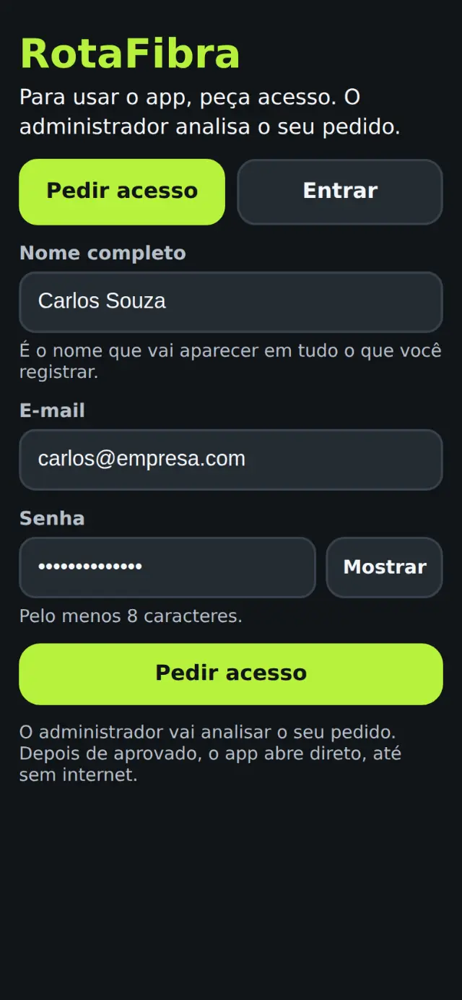

3. **Aguarde a aprovação.** O pedido vai para o administrador. A tela fica em “Aguardando aprovação” e confere sozinha de tempos em tempos; o app abre assim que for aprovado.
   - 👉 Para conferir na hora, toque em Verificar agora

   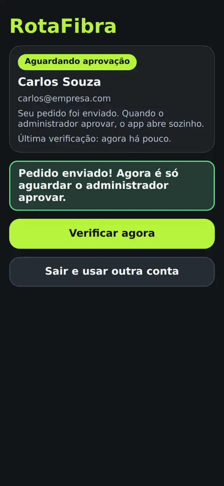

4. **O app abre no mapa.** Aprovado, o app abre no mapa. Dali em diante ele funciona também sem internet: se você fechar e abrir de novo, mesmo no modo avião, ele abre direto.
   - 👉 Toque em “Nenhuma atividade aberta” para começar

   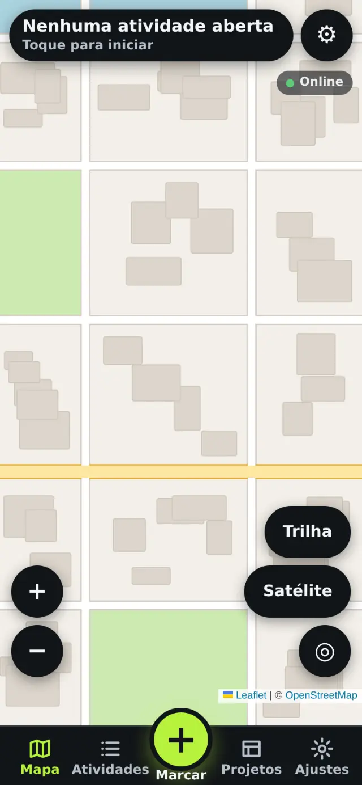

5. **Nas próximas vezes: Entrar.** Se você sair da conta ou trocar de aparelho, use “Entrar” com o e-mail e a senha. O que já estava no aparelho continua lá.
   - 👉 Toque em Entrar

   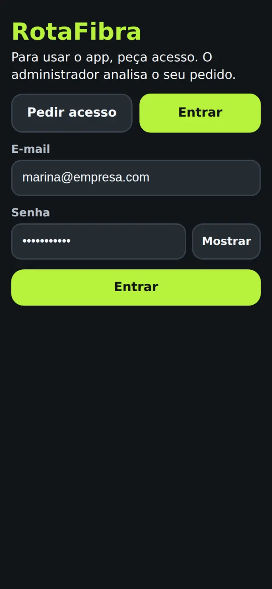

6. **Muitas senhas erradas travam a tela.** Depois de 5 erros seguidos o aparelho trava a tela por 5 minutos (e por mais tempo se continuar errando) e mostra a contagem. Falta de internet e e-mail digitado errado não contam como tentativa.
   - Atenção: Espere a contagem terminar e tente de novo com calma.

   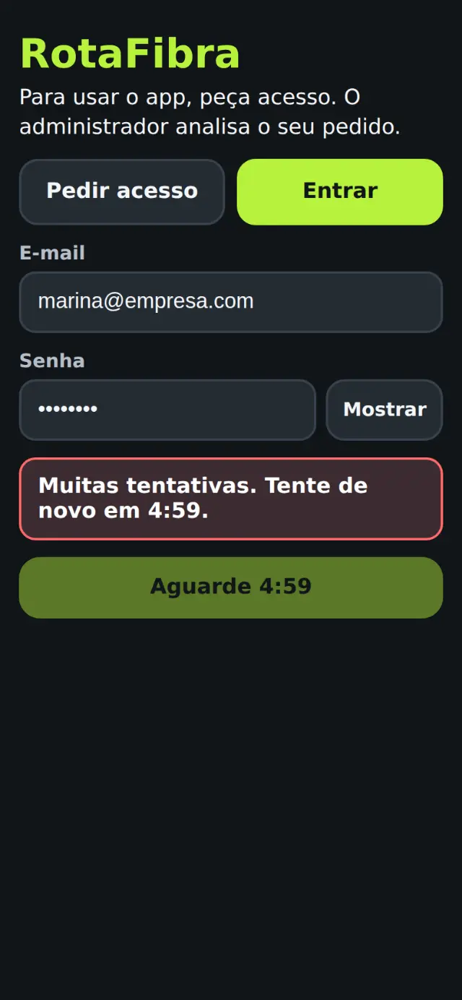

**Como conferir que deu certo**

- O app mostra o mapa e a barra de baixo (Mapa, Atividades, + Marcar, Projetos, Ajustes).
- Com o modo avião ligado, fechar e abrir o app abre direto no mapa.

**Se der errado**

- “Aguardando aprovação” por muito tempo: avise o administrador. Ele aprova em Ajustes › Administração › Pessoas.
- “Acesso desativado”: o administrador desativou este acesso; fale com ele.
- Senha errada várias vezes: a tela trava por alguns minutos; espere a contagem terminar.

## POP-02 · Começar e concluir uma atividade

**Quem faz:** Técnico de campo.

**Objetivo:** Abrir uma atividade antes de trabalhar e concluí-la ao terminar o serviço.

**Antes de começar**

- Acesso aprovado.
- Se o serviço veio de um projeto do administrador, use “Iniciar este projeto” (capítulo Projeto designado).

**Passo a passo**

1. **Dê nome à atividade.** Escolha o tipo (Implantação ou Manutenção), escreva o título e, se tiver, o número da OS. O seu nome já vem do cadastro.
   - 👉 Toque em Iniciar atividade
   - Atenção: Só pode haver uma atividade aberta por vez.

   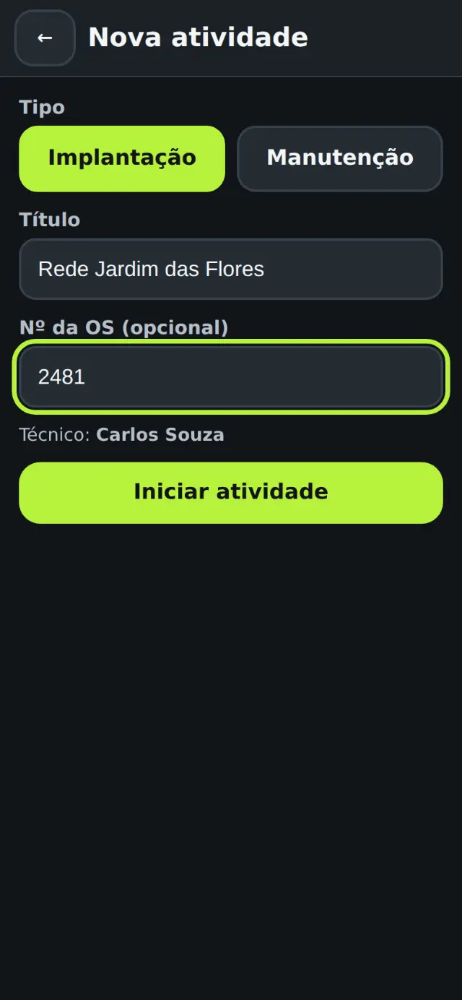

2. **Atividade aberta.** O título aparece no alto do mapa. Tudo o que você marcar a partir de agora entra nesta atividade. O botão verde + Marcar fica no meio da barra de baixo.
   - 👉 Toque em + Marcar quando for marcar algo

   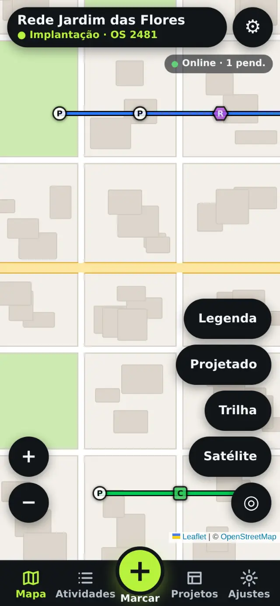

3. **Suas atividades.** Em Atividades você vê tudo o que já fez, com busca e filtros. Cada cartão tem Abrir, Reabrir e Exportar.

   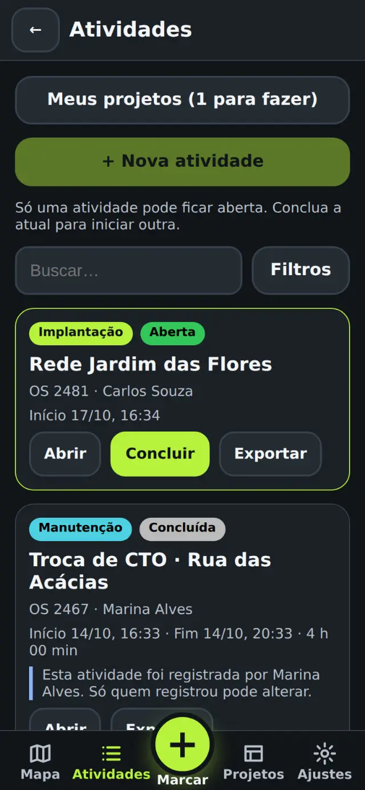

4. **Concluir a atividade.** Abra a atividade para ver materiais, metros de cabo e totais. Quando terminar o serviço, conclua.
   - 👉 Toque em Concluir
   - Dica: Concluiu por engano? Use Reabrir.

   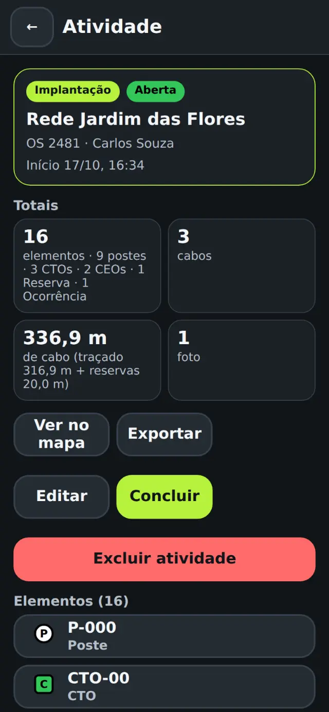

5. **Atividade concluída.** Ela fica como “Concluída”, com a hora do fim. Para mudar título, OS, descrição e materiais, use Editar.

   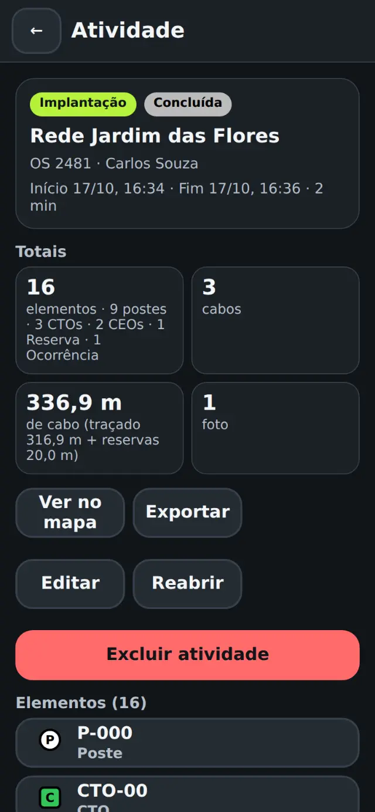

**Como conferir que deu certo**

- O título da atividade aparece no alto do mapa, com o tipo e a OS.
- Na lista de Atividades ela aparece como “Concluída”, com a hora do fim.

**Se der errado**

- O app só deixa uma atividade aberta por vez: conclua a aberta antes de iniciar outra.
- Concluiu por engano: abra a atividade e toque em Reabrir.

## POP-03 · Marcar poste, CTO, CEO e ocorrência

**Quem faz:** Técnico de campo.

**Objetivo:** Registrar cada poste, CTO, CEO, reserva ou ocorrência com a posição e a precisão do GPS.

**Antes de começar**

- Uma atividade aberta.
- GPS do celular ligado e permissão de localização dada ao app.
- De preferência, céu aberto: a precisão é melhor.

**Passo a passo**

1. **Escolha o tipo.** Toque em + Marcar e escolha o que está marcando: Poste, CTO, CEO, Reserva, Ocorrência ou Outro. Para lançar cabo, veja o capítulo seguinte.
   - 👉 Toque em Poste

   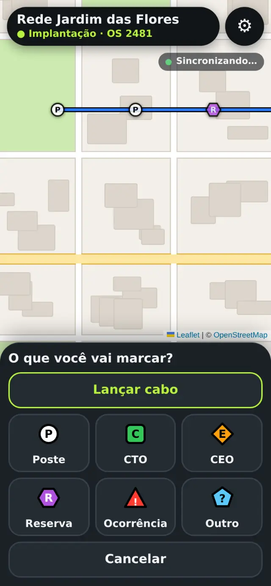

2. **O GPS pega a posição.** O app procura o sinal e mostra a precisão em metros. Com precisão boa (até 15 m) a posição fica pronta na hora.
   - 👉 Toque em Continuar

   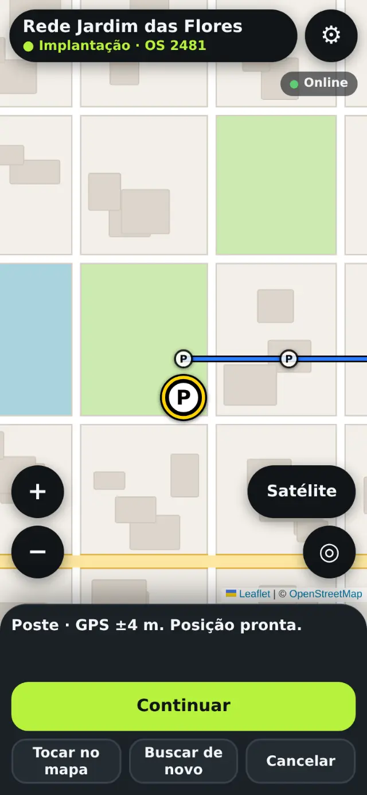

3. **GPS ruim? Ajuste no satélite.** Se a precisão passar de 15 m o app avisa e mostra o satélite. Arraste o marcador até o ponto certo, ou use “Tocar no mapa” ou “Buscar de novo”.
   - 👉 Toque em Continuar quando o marcador estiver no lugar
   - Atenção: Um ponto arrastado vira posição manual: o app deixa de mostrar a precisão do GPS.

   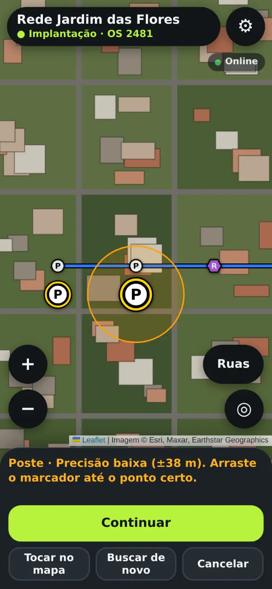

4. **Preencha a ficha e tire a foto.** Escreva a identificação (a plaqueta) e o que mais souber. “Tirar foto” abre a câmera traseira; a foto é reduzida e fica no aparelho.
   - 👉 Toque em Salvar Poste

   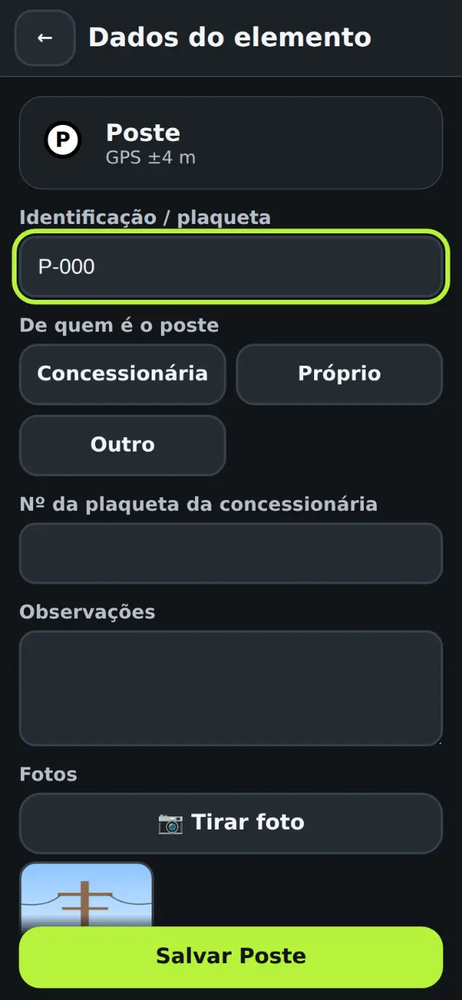

5. **Cada tipo tem os seus campos.** A CTO pede capacidade e splitter; a CEO, bandejas e emendas; a reserva, os metros; a ocorrência, o problema e o que foi feito.
   - 👉 Toque em Salvar CTO

   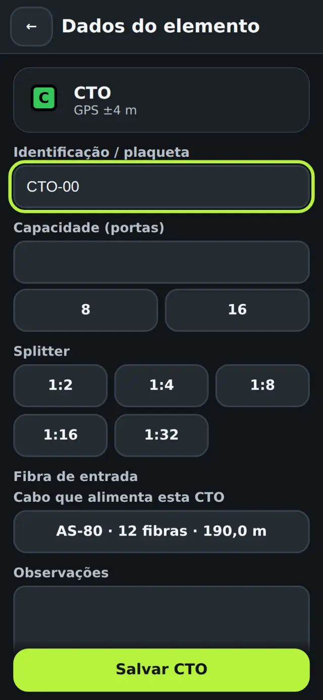

6. **Ocorrência (manutenção).** Marque o problema (rompimento, atenuação, poste caído, caixa danificada ou outro) e escreva o que foi feito.
   - 👉 Toque em Salvar Ocorrência

   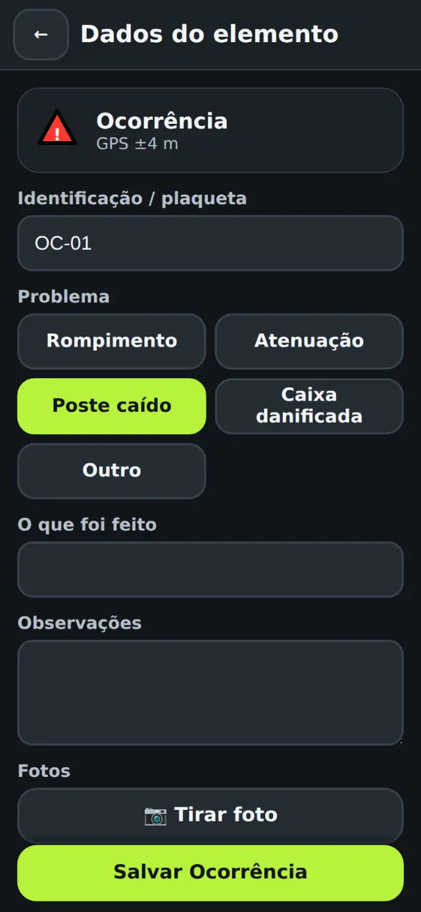

7. **Abrir, editar e mover.** Toque num elemento no mapa para abrir a ficha. Dali você edita, move (arrastando) ou exclui, e vê as fotos.
   - 👉 Toque em Mover para mudar de lugar

   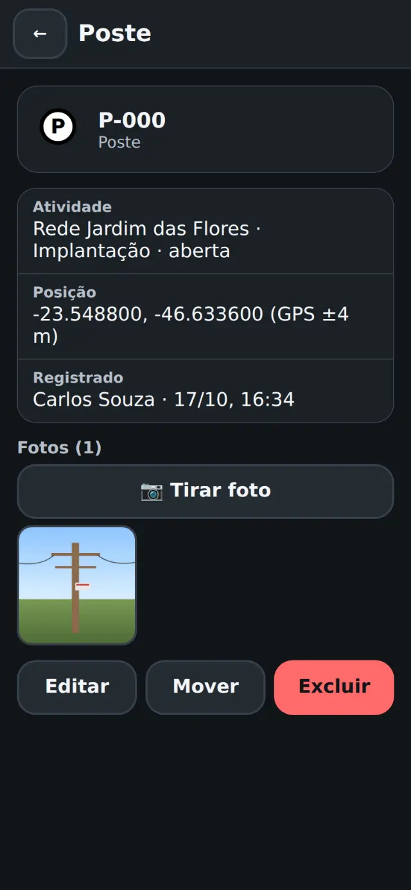

8. **Excluir sempre pede confirmação.** Antes de excluir o app pergunta e avisa o que sai junto, como as fotos. O registro some das telas, mas não quebra o que já foi sincronizado.
   - 👉 Toque em Cancelar para desistir

   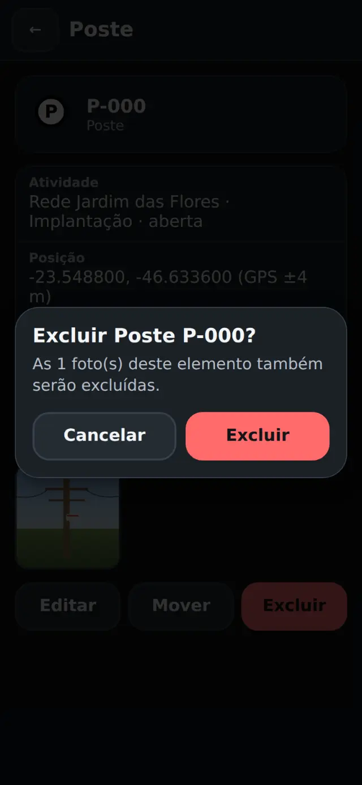

**Como conferir que deu certo**

- O elemento aparece no mapa com o ícone do tipo.
- Na ficha, a posição mostra a precisão (GPS ±4 m, por exemplo).
- A foto aparece como miniatura em “Fotos”.

**Se der errado**

- Precisão acima de 15 m: o app avisa; arraste o marcador sobre o satélite até o ponto certo ou use “Tocar no mapa”.
- “Ainda sem sinal de GPS”: espere alguns segundos, vá para um lugar aberto ou toque no mapa para marcar à mão.
- Marcou o tipo errado: abra a ficha, exclua (com confirmação) e marque de novo.

## POP-04 · Lançar cabo poste a poste, com ramais

**Quem faz:** Técnico de campo.

**Objetivo:** Registrar o traçado do cabo ligando os elementos, com o tronco, os ramais, as reservas e a fibra de cada CTO.

**Antes de começar**

- Uma atividade aberta.
- Saber o tipo do cabo (drop, AS-80, AS-120…) e a quantidade de fibras.
- Estar em cima do poste ao marcar (o ponto vem do GPS).

**Passo a passo**

1. **Escolha o cabo.** Em + Marcar, toque em “Lançar cabo”. Escolha o tipo (drop, AS-80, AS-120…), a quantidade de fibras e o padrão de cores das fibras (ABNT ou Internacional).
   - 👉 Toque em Começar a lançar

   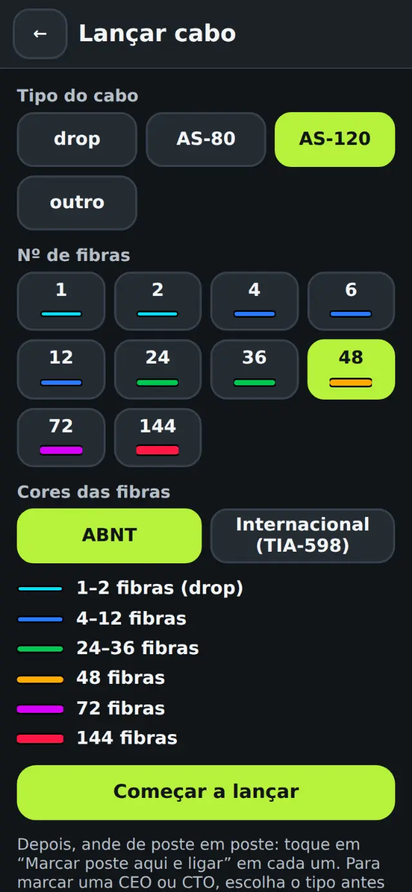

2. **Marque o primeiro poste.** Fique em cima do poste e toque no círculo MARCAR. O app usa o GPS, guarda o ponto e já liga ao anterior. Os metros crescem a cada ponto.
   - 👉 Toque em MARCAR
   - Dica: Errou um ponto? Desfazer tira o último. Para CEO ou CTO, escolha o tipo na pílula acima do botão antes de marcar; depois ele volta para Poste sozinho.

   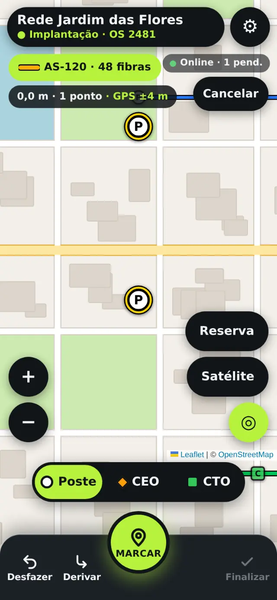

3. **Reserva de cabo.** Deixou uma sobra de cabo no poste? Toque em Reserva e diga quantos metros. Ela entra no total do cabo.
   - 👉 Toque em Adicionar

   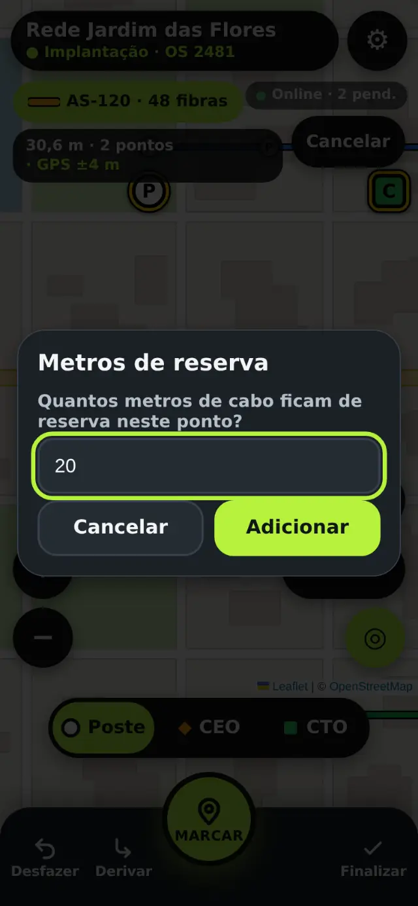

4. **Marque a CEO e derive o ramal.** Numa CEO ou CTO o cabo pode se dividir. “Derivar” abre um ramal que sai daquele ponto.
   - 👉 Toque em Derivar

   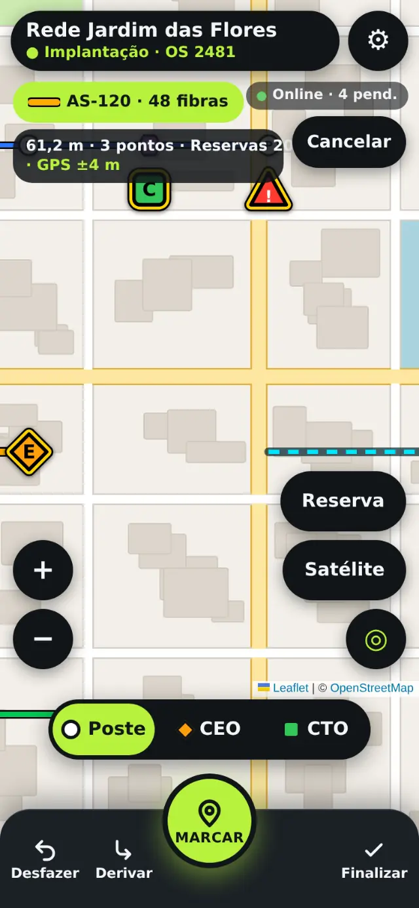

5. **Cabo do ramal.** Escolha o tipo e as fibras do ramal (a tela já traz as do cabo de origem, ou as do último ramal).
   - 👉 Toque em Derivar

   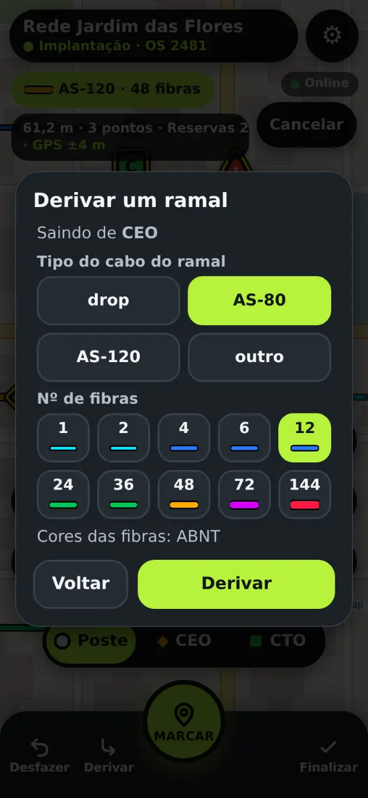

6. **Marque o ramal e termine.** No alto aparece o caminho “Tronco › Ramal 1”. Marque os postes e a CTO do ramal. Terminou? Toque em Terminar: você volta ao tronco, que segue da CEO.
   - 👉 Toque em Terminar

   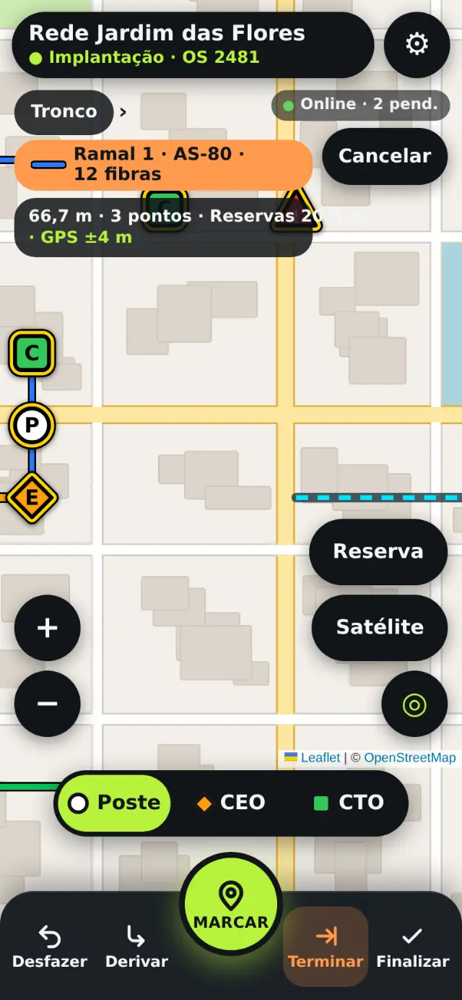

7. **Finalizar: o resumo.** Ao finalizar o app lista o tronco e cada ramal, com os metros, as reservas e o total do lançamento.

   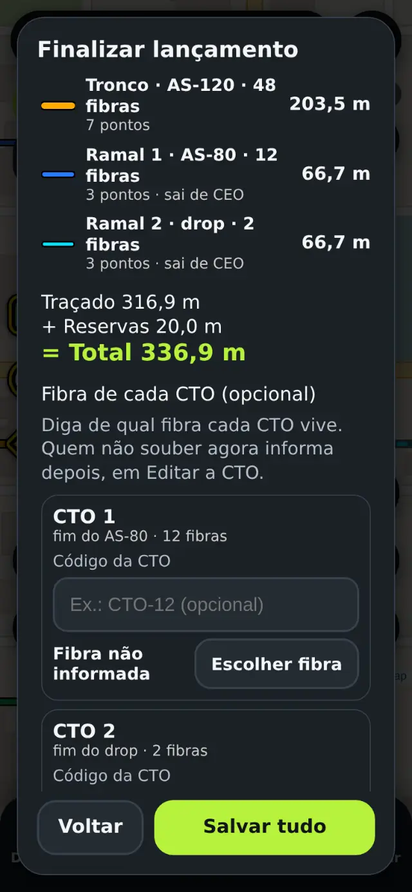

8. **Fibra de cada CTO.** Para cada CTO diga de qual fibra do cabo ela vive: tubo e cor, no padrão escolhido. Quem não souber agora informa depois, em Editar.
   - 👉 Toque na fibra (por exemplo, Branco)

   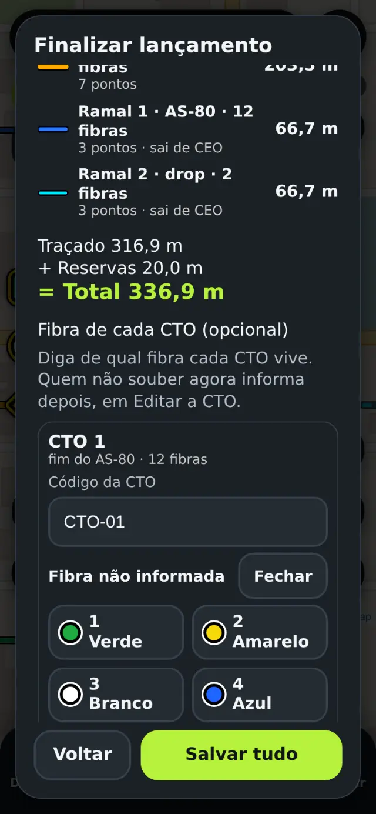

9. **Salvar tudo.** Confira e salve de uma vez. O tronco e os ramais já saem ligados no elemento da derivação.
   - 👉 Toque em Salvar tudo

   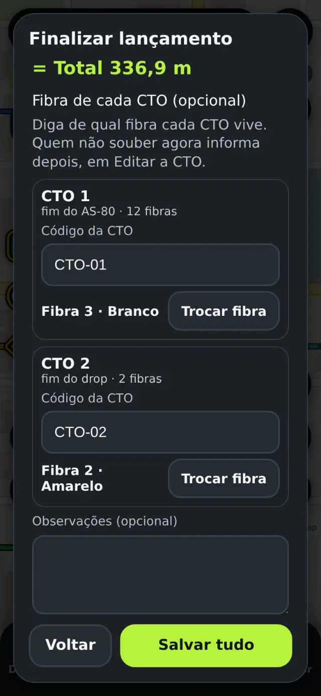

10. **Cabos salvos.** O aviso diz quantos cabos foram salvos e o total de metros. A rede aparece no mapa, cada cabo na cor e na espessura da sua quantidade de fibras.

   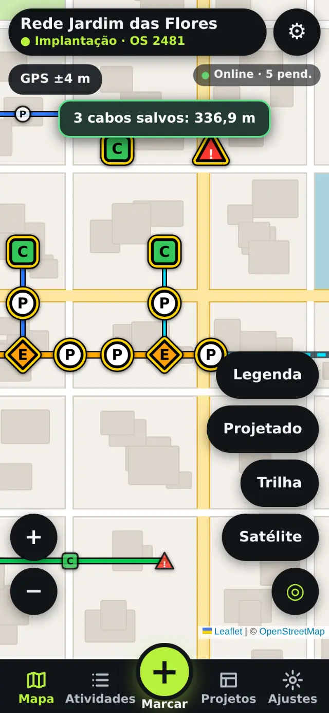

**Como conferir que deu certo**

- Os metros do cabo crescem a cada ponto marcado.
- No resumo, o tronco e cada ramal aparecem com os seus metros e o total bate com o esperado.
- Depois de salvar, o mapa mostra o tronco e os ramais ligados.

**Se der errado**

- Marcou um ponto errado: toque em Desfazer (tira o último ponto; repetindo, volta o “terminar ramal” e a própria derivação).
- Quer desistir do lançamento todo: Cancelar (pede confirmação).
- Fechou o app no meio: ao abrir, o lançamento volta de onde parou, ainda dentro do ramal.
- “Derive de um poste, CEO ou CTO”: a derivação só abre num ponto que existe, não num toque solto no mapa.

## POP-05 · Fibras, ligações e rota acesa

**Quem faz:** Técnico de campo.

**Objetivo:** Conferir as fibras de um cabo, ligar cabos no ponto onde se encontram e saber, para cada CTO, qual fibra a alimenta.

**Antes de começar**

- Os cabos já salvos.
- Saber, de cada CTO, o cabo e a fibra de entrada.

**Passo a passo**

1. **Ficha do cabo e fibras.** Abra um cabo no mapa. A ficha mostra as fibras com cor e número, agrupadas em tubos (12 fibras por tubo, nos cabos acima de 12 fibras). A fibra usada por uma CTO aparece marcada.
   - 👉 Toque num tubo para abrir ou fechar

   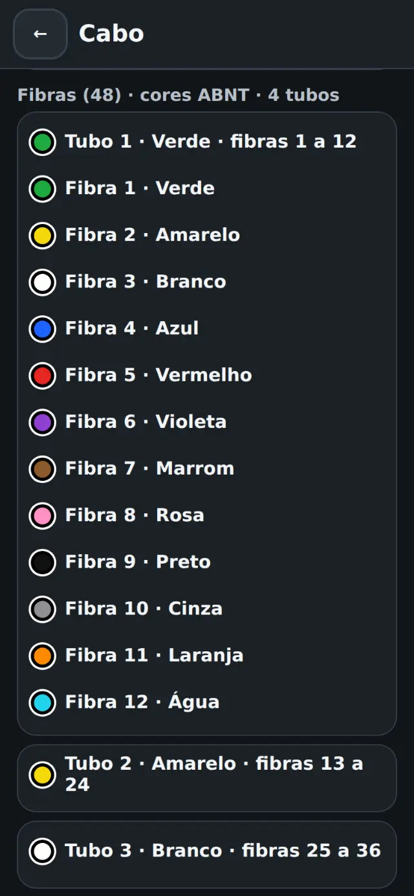

2. **Ligar cabos num ponto.** Onde dois cabos se encontram (numa CEO, poste ou CTO), marque quais continuam um no outro e toque em Salvar ligações. Quem lança a rede toda de uma vez já sai ligado.
   - 👉 Toque num cabo para marcar ou desmarcar
   - Atenção: O app liga cabo com cabo no ponto. A emenda fibra a fibra ainda não existe.

   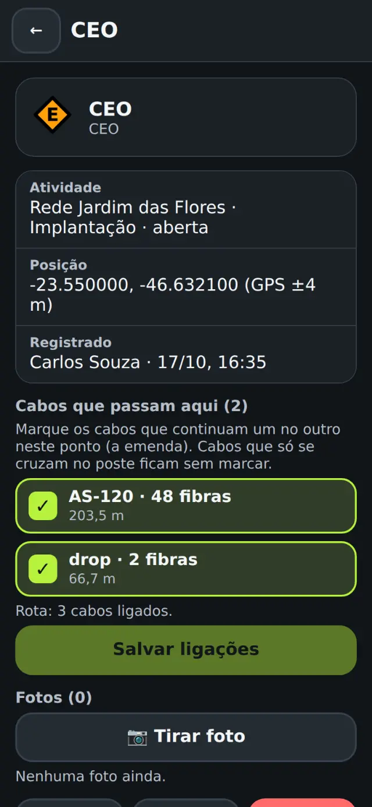

3. **Fibra de entrada da CTO.** A ficha da CTO mostra qual cabo e qual fibra a alimentam (por exemplo, Fibra 3 · Branco). Para mudar, toque em Editar.
   - 👉 Toque em Editar

   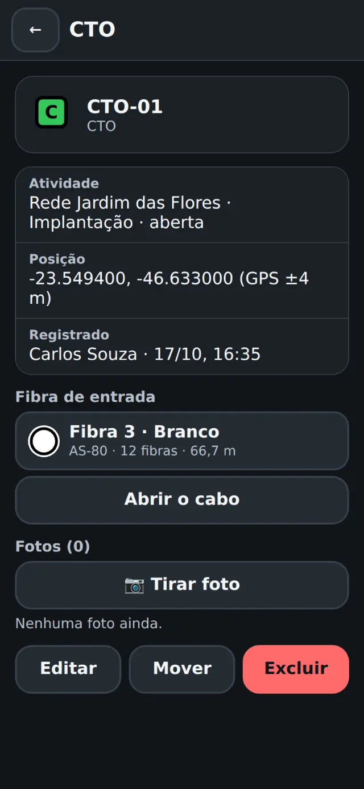

4. **Ver a rota no mapa.** Na ficha do cabo, “Ver a rota no mapa” acende todos os cabos ligados a ele.
   - 👉 Toque em Ver a rota no mapa

   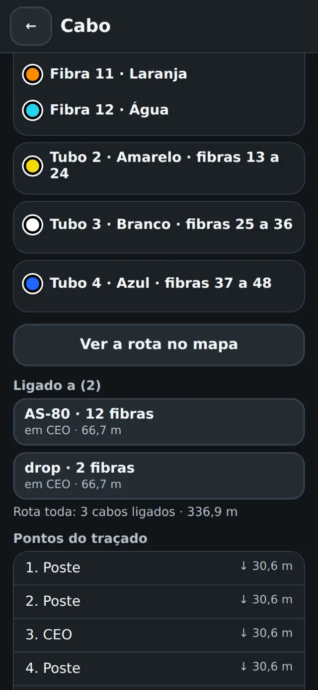

5. **A rota acesa.** Os cabos da rota ficam com halo amarelo e o resto esmaece. A folha de baixo mostra “Rota: 3 cabos · 336,9 m · 2 CTOs” e a fibra de cada CTO. Dá para abrir um cabo ou uma CTO da lista.
   - 👉 Toque em Fechar para apagar a rota
   - Dica: Tocar em qualquer parte de um cabo, no mapa, também acende a rota.

   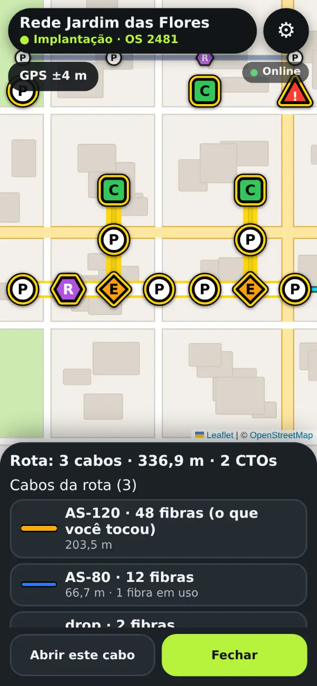

6. **A rede no mapa.** Postes, CEOs, CTOs, reservas e ocorrências, com os cabos na cor e na espessura da quantidade de fibras. O botão Legenda explica cada símbolo.

   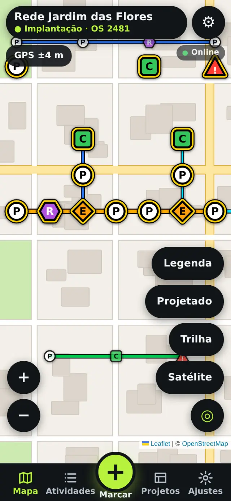

**Como conferir que deu certo**

- A ficha da CTO mostra “Fibra de entrada”, por exemplo “Fibra 3 · Branco”.
- Na ficha do cabo a fibra usada aparece marcada com a CTO.
- Ao tocar num cabo, a rota acende com “Rota: N cabos · metros · N CTOs”.

**Se der errado**

- Escolheu uma fibra que outra CTO já usa: o app avisa antes de salvar.
- Marcou só um cabo no ponto: o app avisa que é preciso pelo menos dois para ligar.
- Emenda fibra a fibra (qual fibra do cabo A com qual do B) ainda não existe no app.

## POP-06 · Projeto que o administrador entregou

**Quem faz:** Técnico de campo.

**Objetivo:** Executar um projeto designado pelo administrador, seguindo o desenho dele como guia.

**Antes de começar**

- Abrir o app com internet pelo menos uma vez depois que o administrador entregou o projeto (depois funciona sem internet).
- Nenhuma outra atividade aberta.

**Passo a passo**

1. **Aviso ao abrir o app.** Quando o administrador entrega um projeto, ao abrir o app aparece “Você tem N projetos para fazer”. “Depois” esconde o aviso até abrir o app de novo.
   - 👉 Toque em Ver

   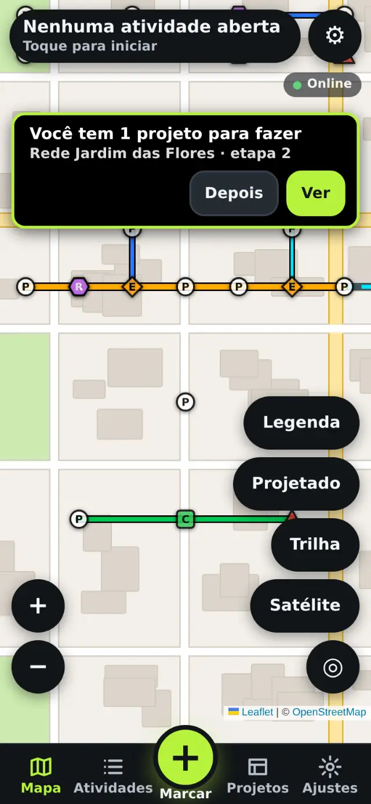

2. **A ficha do projeto.** Veja as instruções, o prazo, o endereço e o desenho que o administrador fez. “Ver no mapa” centraliza no ponto e “Como chegar” abre o aplicativo de mapas do celular.
   - 👉 Toque em Ver desenho no mapa

   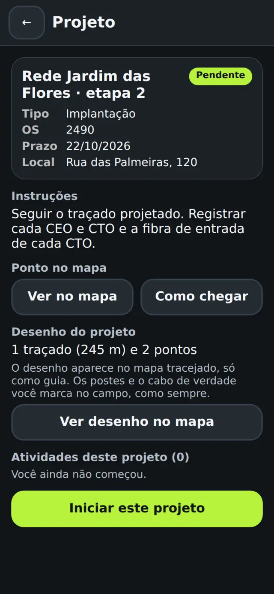

3. **O desenho aparece tracejado.** Na camada “Projetado”, o traçado e os pontos do projeto aparecem tracejados, só como guia. Eles não viram cabo nem elemento: você marca no campo, como sempre.
   - 👉 Toque em Projetado para ligar ou desligar

   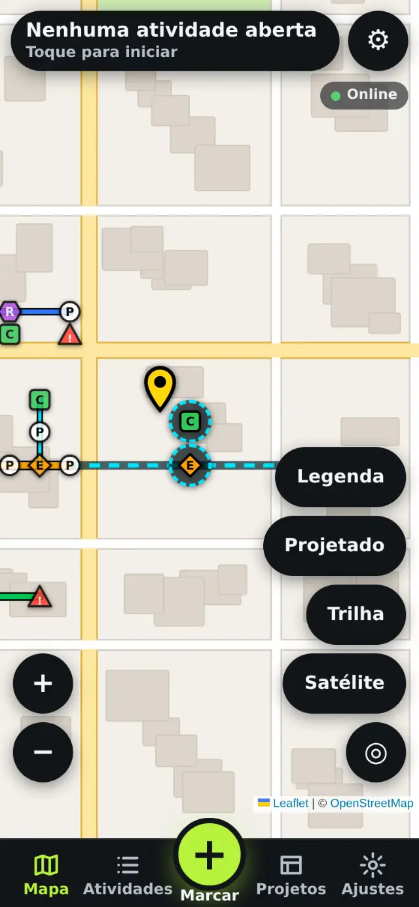

4. **Iniciar o projeto.** Iniciar cria a atividade já com o nome, o tipo e a OS do projeto, e o projeto passa a “Em andamento”.
   - 👉 Toque em Iniciar este projeto
   - Atenção: Com outra atividade aberta, o app avisa e não deixa iniciar.

   

5. **Trabalhe como sempre.** A atividade do projeto está aberta. Marque elementos e lance cabos normalmente, seguindo o desenho.
   - 👉 Toque na atividade quando terminar, para concluir

   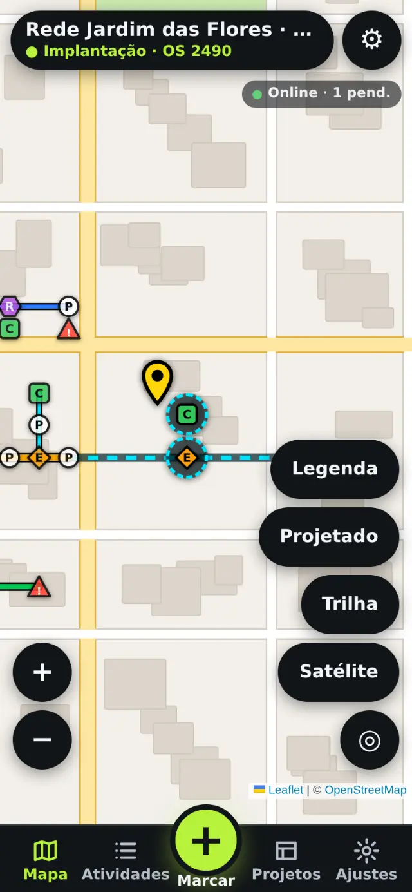

6. **Este projeto está concluído?.** Ao concluir a atividade do projeto, o app pergunta se o projeto terminou. “Sim” conclui o projeto; “Não, ainda falta fazer” conclui só a atividade; “Voltar” desiste.
   - 👉 Toque em Sim, o projeto está concluído

   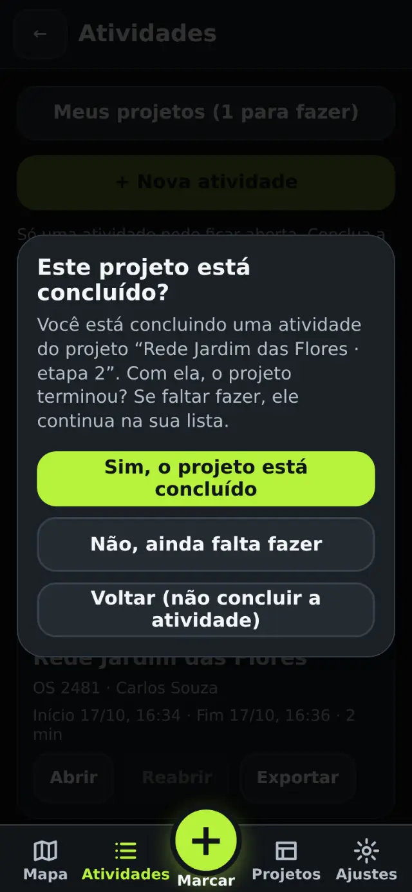

7. **No histórico.** A atividade fica concluída e ligada ao projeto. O escritório acompanha o andamento no painel.

   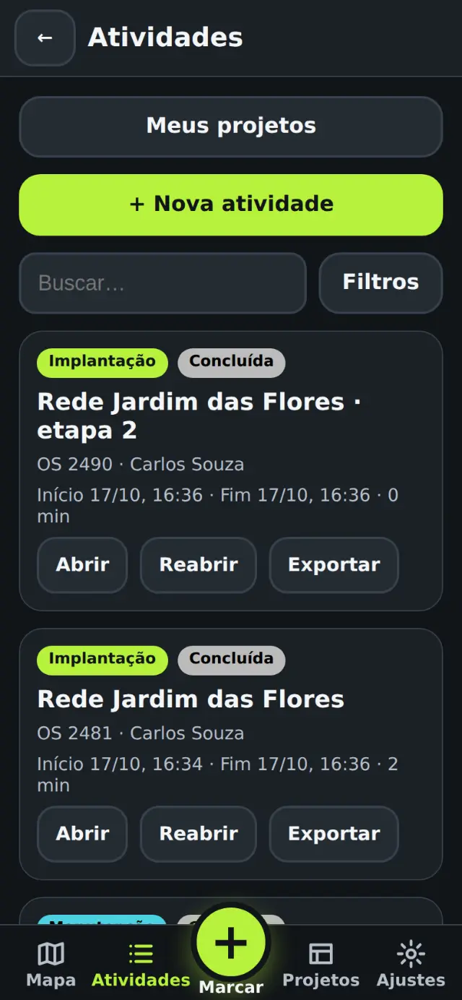

**Como conferir que deu certo**

- A atividade nasce com o nome, o tipo e a OS do projeto, e o projeto passa a “Em andamento”.
- Ao concluir, o projeto fica “Concluído” (se você respondeu Sim) e some do aviso.

**Se der errado**

- “Já existe uma atividade aberta”: conclua a atividade aberta antes de iniciar o projeto.
- Respondeu errado se o projeto terminou: abra a atividade concluída e use “Com esta atividade o projeto terminou? Sim / Não”.
- O administrador passou o projeto para outro técnico ou cancelou: ele some da sua lista na próxima sincronização; o que você já fez continua.

## POP-07 · Trilha GPS e camadas de referência

**Quem faz:** Técnico de campo.

**Objetivo:** Registrar o caminho percorrido (trilha) e consultar no mapa uma rede que veio de um arquivo KML/KMZ.

**Antes de começar**

- Uma atividade aberta (para a trilha).
- Para as camadas: o arquivo .kml ou .kmz no celular.

**Passo a passo**

1. **Gravar a trilha.** A trilha é o registro do seu deslocamento, separado do cabo. Ela nunca vira cabo sozinha.
   - 👉 Toque em Iniciar gravação
   - Atenção: A gravação para se a tela apagar ou o app for fechado: mantenha o app aberto e a tela ligada.

   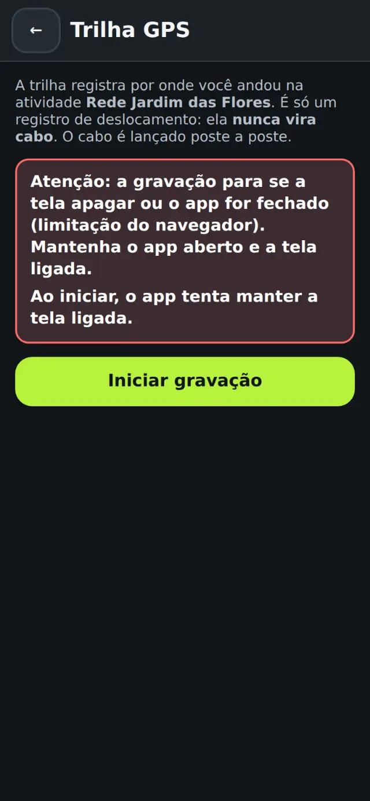

2. **Pausar e encerrar.** Enquanto grava, a tela mostra o tempo, a distância e a precisão do GPS, e a trilha aparece tracejada no mapa. Pausar e Encerrar ficam à mão. O app descarta pontos com precisão pior que 30 m e pontos a menos de 5 m do anterior.
   - 👉 Toque em Pausar para parar um instante

   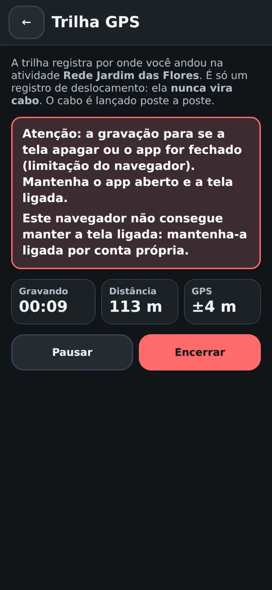

3. **Camadas de referência (KML/KMZ).** Importe o arquivo KML ou KMZ de uma rede existente para consultar no mapa e, se quiser, converter pontos em elementos. A camada é só de consulta, fica salva no aparelho mesmo sem internet e não entra no backup.
   - 👉 Toque em Importar arquivo KML/KMZ

   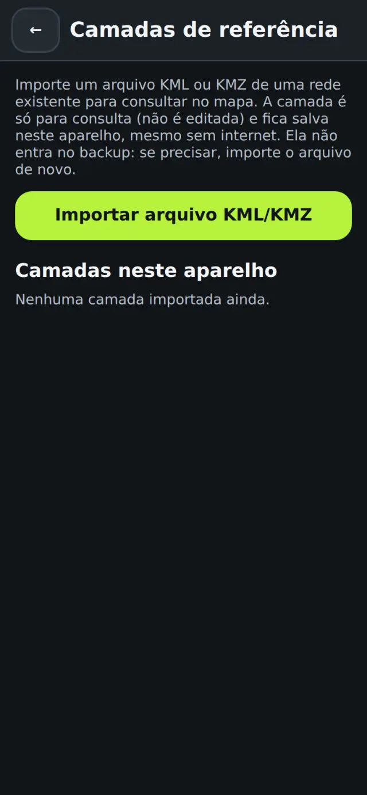

**Como conferir que deu certo**

- A trilha aparece tracejada no mapa; a tela mostra os pontos e os metros.
- A camada importada aparece em Camadas e liga e desliga no botão Referência do mapa.

**Se der errado**

- A trilha nunca vira cabo sozinha: o cabo se desenha poste a poste.
- Arquivo que não é KML/KMZ: o app avisa e não importa nada.

## POP-08 · Sem internet e sincronização

**Quem faz:** Técnico de campo.

**Objetivo:** Trabalhar sem internet e conferir que o que foi registrado subiu para o servidor.

**Antes de começar**

- Acesso aprovado e o app aberto com internet pelo menos uma vez.

**Passo a passo**

1. **Sem internet, nada para.** Tudo é salvo primeiro no aparelho. O indicador mostra “Offline” e quantos registros esperam para subir.

   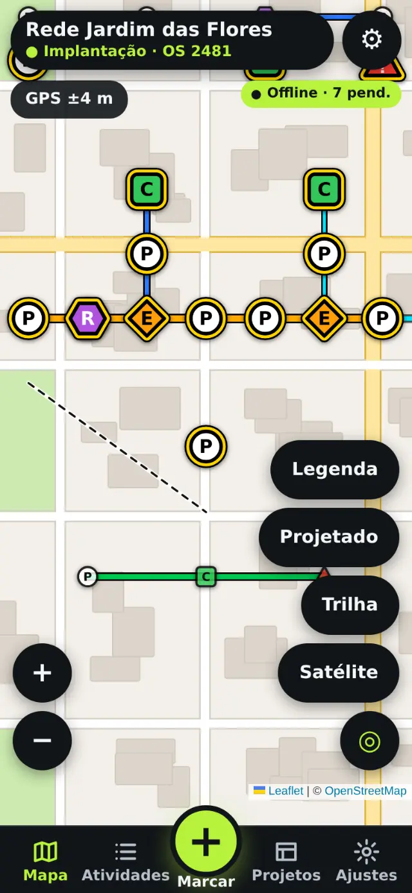

2. **A internet voltou.** Com a internet de volta, o indicador passa para “Online” e tudo sobe sozinho, sem você fazer nada. No Android o envio acontece até com o app fechado; no iPhone, ao abrir o app.

   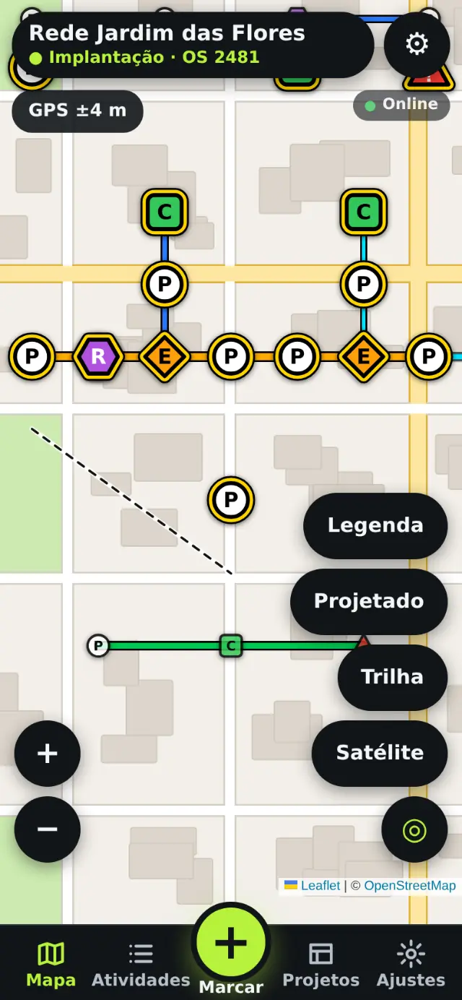

3. **Tela Sincronização.** Em Ajustes › Conta › Sincronização você vê a situação (“Tudo enviado”), pode tocar em Sincronizar agora, e vê o que o servidor recusou (com o motivo) e as alterações que foram substituídas. As fotos sobem junto com os dados.

   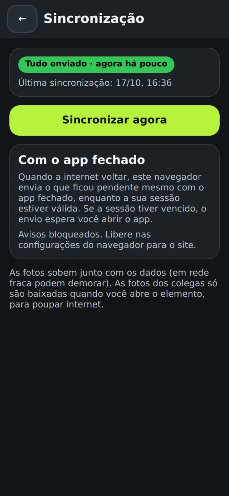

**Como conferir que deu certo**

- O indicador volta a “Online” e a contagem de pendentes chega a zero.
- Em Ajustes › Conta › Sincronização, a situação diz “Tudo enviado”.

**Se der errado**

- Pendentes que não sobem: abra a tela Sincronização; registros recusados aparecem ali, com o motivo.
- Sessão vencida: o app pede para você entrar de novo; os dados do aparelho continuam lá.
- No iPhone o envio só acontece com o app aberto; no Android pode acontecer com o app fechado.

## POP-09 · Backup e exportar

**Quem faz:** Técnico de campo (e o escritório, para abrir o arquivo).

**Objetivo:** Ter uma cópia dos dados do aparelho e exportar a rede para o Google Earth ou o QGIS.

**Antes de começar**

- Ao menos uma atividade registrada.

**Passo a passo**

1. **Backup do aparelho.** Prepare o arquivo de backup e guarde onde quiser: ele não vai para o servidor. Para restaurar (em outro aparelho, por exemplo), use “Escolher arquivo de backup”. O app também lembra de fazer o backup de tempos em tempos. “Proteger os dados” pede ao navegador para não apagar os dados do app.
   - 👉 Toque em Preparar backup

   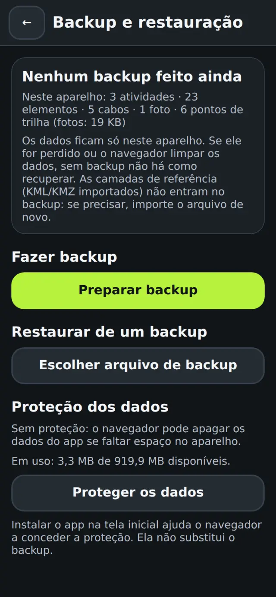

2. **Exportar para o Google Earth.** Escolha o que exportar (só os seus registros, a rede inteira ou uma atividade), o formato (KMZ para o Google Earth, GeoJSON para o QGIS) e se leva as fotos. Elementos, cabos e trilhas saem no arquivo.
   - 👉 Toque em Preparar arquivo

   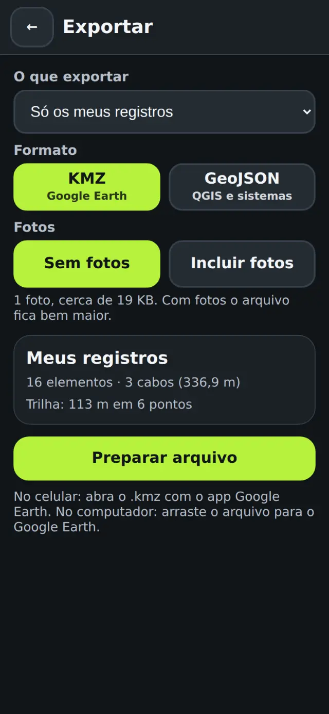

**Como conferir que deu certo**

- O arquivo de backup foi salvo ou compartilhado e o app mostra “Último backup há …” em Ajustes.
- O arquivo KMZ abre no Google Earth com os elementos, cabos e trilhas.

**Se der errado**

- O backup não vai para o servidor: guarde o arquivo em um lugar seguro (e-mail, nuvem).
- Para restaurar em outro aparelho use “Escolher arquivo de backup”.

## POP-10 · Ajustes: Como usar, tema e conta

**Quem faz:** Técnico de campo.

**Objetivo:** Conhecer os Ajustes: abrir o Como usar, escolher o tema, os tipos de cabo e as cores das fibras.

**Antes de começar**

- Nenhum.

**Passo a passo**

1. **Como usar.** Nos Ajustes, o cartão “Como usar o app” abre este passo a passo quando você quiser.
   - 👉 Toque em Como usar

   

2. **Escolha o tema.** Polegar (grafite e verde-limão) tem contraste alto e é bom ao sol. Fibra (azul-petróleo e ciano) é mais suave e é bom à noite. A escolha vale só neste aparelho.
   - 👉 Toque em Fibra para testar

   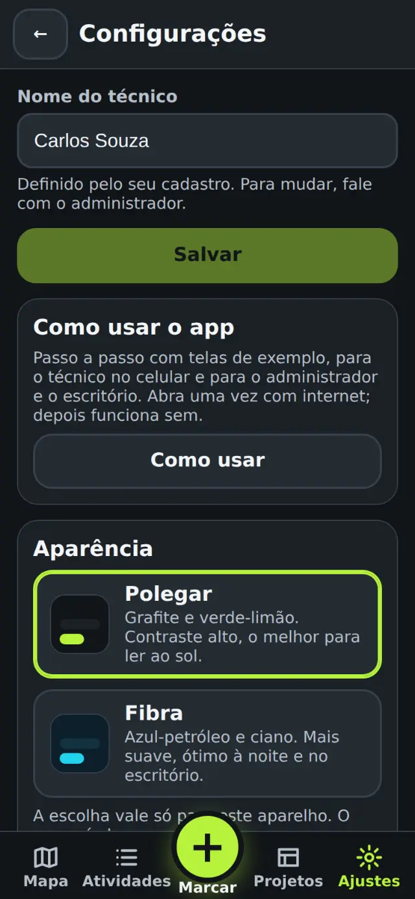

3. **Tema Fibra.** A troca é na hora e continua ao reabrir o app. O mapa continua claro nos dois temas.

   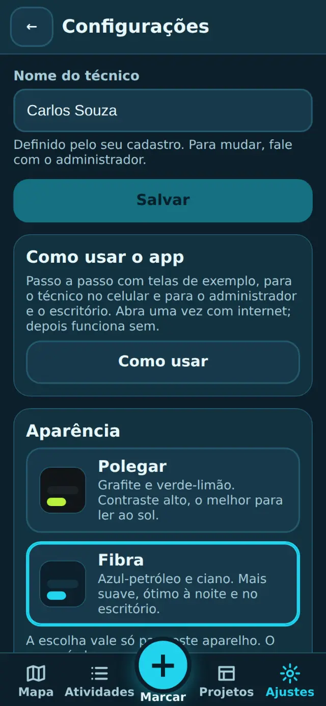

4. **Tipos de cabo e cores das fibras.** Você pode acrescentar ou remover tipos de cabo e escolher o padrão de cores dos cabos novos: ABNT ou Internacional (TIA-598).

   

5. **Conta e sincronização.** Abra a conta para trocar a senha ou sair. Sair não apaga nada do aparelho.
   - 👉 Toque em Sincronização para ver o envio

   

**Como conferir que deu certo**

- O tema escolhido continua depois de fechar e abrir o app.
- Sair da conta não apaga nada do aparelho: ao entrar de novo tudo reaparece.

**Se der errado**

- O nome do técnico não muda no app depois de aprovado: ele vem do cadastro; peça ao administrador.
- O tema vale só neste aparelho: em outro celular, escolha de novo.

---

# Administrador e escritório

Aprovar pessoas, projetos, desenho e painel (no computador; o administrador também no celular).

## POP-11 · Aprovar pessoas (administrador)

**Quem faz:** Administrador.

**Objetivo:** Aprovar, recusar, desativar e mudar o papel das pessoas que usam o app.

**Antes de começar**

- Estar com a conta de administrador e com internet (esta tela precisa do servidor).

**Passo a passo**

1. **Abra Pessoas.** Em Ajustes › Administração (só o administrador vê esse cartão) toque em Pessoas.
   - 👉 Toque em Pessoas

   

2. **Pedidos aguardando.** Quem pediu acesso aparece em “Aguardando aprovação”. Escolha o papel: Técnico (registra e altera o que é dele), Escritório (só consulta e abre o painel) ou Administrador (altera tudo e aprova pessoas).
   - 👉 Escolha o papel e toque em Aprovar

   

3. **Confirme.** O app pergunta, citando a pessoa e o papel, antes de liberar.
   - 👉 Toque em Aprovar

   

4. **Pronto.** A pessoa passa para “Com acesso” e o app dela abre sozinho. Depois você pode mudar o papel, desativar ou reativar.
   - Atenção: Rebaixar um administrador usa um botão vermelho, de perigo.

   

**Como conferir que deu certo**

- A pessoa passa para “Com acesso” e o app dela abre sozinho.
- A lista mostra “Aprovado em … por …”.

**Se der errado**

- “Sem conexão com o servidor”: nada foi alterado; tente de novo com internet.
- Aprovou com o papel errado: use “Mudar papel” (pede confirmação).
- Desativar não apaga nada: o que a pessoa registrou continua; ela só deixa de entrar.

## POP-12 · Criar e entregar um projeto (administrador)

**Quem faz:** Administrador.

**Objetivo:** Criar um projeto e entregá-lo a um técnico, com instruções, local e prazo.

**Antes de começar**

- Conta de administrador, internet (a tela de projetos precisa do servidor).
- O técnico já aprovado.

**Passo a passo**

1. **Lista de projetos.** Em Projetos o administrador vê todos, com filtros (Para fazer, Pendentes, Em andamento, Concluídos, Cancelados), busca e filtro por técnico.
   - 👉 Toque em Novo projeto

   

2. **Preencha o projeto.** Nome, tipo, técnico que vai fazer, OS, instruções, endereço, ponto no mapa (cole as coordenadas do Google Maps, em qualquer formato) e prazo.
   - 👉 Toque em Criar projeto
   - Atenção: Sem nome ou sem técnico o app avisa e não cria.

   

3. **Ficha do projeto.** Aqui você edita, passa para outro técnico, marca como concluído, cancela, reabre ou exclui (cada um pede confirmação). O técnico recebe na próxima sincronização.
   - 👉 Toque em Desenhar no mapa

   

**Como conferir que deu certo**

- O projeto aparece na lista como Pendente (Atrasado, se o prazo passou).
- O técnico recebe “Você tem N projetos para fazer” na próxima vez que abrir o app com internet.

**Se der errado**

- Sem nome ou sem técnico o app mostra o erro e não cria.
- Coordenadas coladas do Google Maps: confira a linha “Entendi: …” antes de criar.
- Sem internet a tela avisa e bloqueia “Novo projeto”.

## POP-13 · Desenhar o projeto no mapa (administrador)

**Quem faz:** Administrador.

**Objetivo:** Desenhar no mapa o traçado e os pontos do projeto, para o técnico seguir como guia.

**Antes de começar**

- Projeto criado.
- Internet (salvar o desenho precisa do servidor).
- Opcional: um arquivo KML/KMZ com a rota.

**Passo a passo**

1. **Escolha a ferramenta.** Selecionar mexe no que já existe; Traçado desenha a rota do cabo; Ponto marca poste, CTO, CEO ou reserva.
   - 👉 Clique em Traçado

   

2. **Desenhe o traçado.** Clique (ou toque) no mapa para marcar cada ponto do traçado. O resumo mostra os metros. Terminou? Clique em Terminar traçado.
   - 👉 Clique em Terminar traçado

   

3. **Marque os pontos.** Escolha o tipo (Poste, CTO, CEO, Reserva, Outro), clique no mapa e escreva o código. Desfazer e Refazer ajudam a corrigir.
   - 👉 Clique em Salvar desenho

   

4. **Desenho salvo.** O técnico recebe o desenho na próxima sincronização e o vê tracejado, como guia, na camada “Projetado”. O escritório vê no mapa do painel. Importar KML/KMZ também fica aqui.
   - 👉 Para trazer linhas e pontos de um arquivo, use Importar KML/KMZ

   

**Como conferir que deu certo**

- O resumo mostra os traçados, os metros e os pontos.
- Depois de salvar: “Desenho salvo. O técnico recebe na próxima sincronização.”
- O técnico vê o desenho tracejado na camada “Projetado”; o escritório vê no mapa do painel.

**Se der errado**

- Errou um ponto: Desfazer e Refazer.
- Sair com mudanças não salvas pede confirmação; “Apagar tudo” também (dá para Desfazer).
- Importar KML/KMZ: pontos viram “Outro” e áreas (polígonos) não entram; o aviso diz quantas ficaram de fora.

## POP-14 · Painel do escritório: mapa da rede

**Quem faz:** Escritório e administrador.

**Objetivo:** Acompanhar a rede e o trabalho dos técnicos pelo computador, só leitura.

**Antes de começar**

- Conta de escritório ou de administrador, aprovada.
- O painel mostra o que este navegador já sincronizou: abra o app com internet para atualizar.

**Passo a passo**

1. **Abrir o painel.** O escritório e o administrador têm o cartão Painel em Ajustes: a rede inteira em tela grande, só leitura.
   - 👉 Clique em Abrir o painel

   

2. **Visão geral.** Técnicos, atividades, elementos, cabos, metros e projetos, tudo do que este navegador já sincronizou. “Sincronizar agora” atualiza.
   - 👉 Clique em Mapa da rede

   

3. **Mapa da rede.** Filtre por técnico, tipo, situação e período; busque um código de poste ou um tipo de cabo; alterne entre Ruas e Satélite.
   - 👉 Clique na busca e digite

   

4. **Achar um cabo.** A busca acha pelo código, pela OS, pelo título e pelo que há dentro da atividade (por exemplo, o tipo de cabo).
   - 👉 Clique no resultado

   

5. **Ficha do cabo.** Mostra a atividade, os metros, a rota e as CTOs com a fibra de cada uma.
   - 👉 Clique em Mostrar no mapa

   

6. **Rota inteira.** O mapa enquadra a rota toda. Clicar em qualquer cabo acende a rota dele.

   

**Como conferir que deu certo**

- A Visão geral bate com o que os técnicos registraram.
- Ao clicar num cabo, a rota acende e a ficha mostra as CTOs com a fibra de cada uma.

**Se der errado**

- Faltam dados recentes: “Sincronizar agora”, na Visão geral.
- O painel não tem Editar, Excluir nem Concluir: ele só consulta.
- Muitos pontos na tela: afaste o zoom e aparecem bolinhas; aproxime e voltam os símbolos.

## POP-15 · Painel: atividades, projetos e totais

**Quem faz:** Escritório e administrador.

**Objetivo:** Consultar atividades, projetos e totais por técnico e período, e exportar em CSV.

**Antes de começar**

- Acesso ao painel e dados sincronizados.

**Passo a passo**

1. **Tabela de atividades.** Uma linha por atividade, ordenável por qualquer coluna, com filtros e busca. O rodapé soma o que está filtrado.
   - 👉 Clique numa linha

   

2. **Ficha da atividade.** Só leitura: materiais, totais, “Ver no mapa” e “Ver trilha GPS” do técnico.

   

3. **Projetos.** Situação, prazo, atividades e metros de cabo de cada projeto, com os atrasados em vermelho. Exporte em CSV.

   

4. **Totais por técnico.** Cabos, metros e elementos por técnico e período. “Exportar CSV” abre no Excel com acentos e vírgula decimal.
   - 👉 Clique em Conferir agora

   

5. **Conferir com o servidor.** Diz “Confere” quando os totais do painel são os mesmos do servidor; se faltar sincronizar, aponta a diferença.

   

**Como conferir que deu certo**

- O rodapé da tabela soma só o que está filtrado.
- “Conferir agora” diz “Confere com o servidor” quando os totais batem.
- O CSV abre no Excel com acentos e vírgula decimal.

**Se der errado**

- “Conferir agora” aponta diferença: falta sincronizar neste navegador; use Sincronizar agora e confira de novo.
- Sem internet o painel continua mostrando e filtrando o que já foi sincronizado.

## POP-16 · Corrigir, acompanhar e excluir (administrador)

**Quem faz:** Administrador.

**Objetivo:** Corrigir registros dos técnicos, acompanhar as alterações e excluir atividades quando preciso.

**Antes de começar**

- Conta de administrador.
- Internet para enviar a correção.

**Passo a passo**

1. **Abra o registro do técnico.** O administrador abre qualquer elemento, cabo ou atividade. A ficha avisa que o registro é de outra pessoa.
   - 👉 Toque em Editar

   

2. **Corrija e salve.** Altere o que precisa. O registro continua sendo do técnico dono e o servidor anota quem alterou, quando e o quê.
   - 👉 Toque em Salvar

   

3. **Alterações e conflitos.** Em Ajustes › Administração › Alterações e conflitos aparece quem alterou, quando e o que mudou (por exemplo, Identificação: P-101 → P-101A). Conflitos mostram o que foi substituído.

   

4. **Atividades de todos.** O administrador vê as atividades de todos os técnicos, com os mesmos filtros e a busca.

   

5. **Ficha da atividade de um colega.** Editar, Reabrir, Ver trilha GPS (baixa a trilha do técnico e desenha no mapa) e Excluir atividade.
   - 👉 Toque em Excluir atividade

   

6. **Excluir pede confirmação.** A confirmação diz o que sai junto: elementos, cabos, fotos e trilha. A exclusão vale para todos, inclusive para quem registrou.
   - 👉 Toque em Cancelar para desistir
   - Atenção: Não dá para desfazer pelo app.

   

**Como conferir que deu certo**

- A ficha mostra “Você (administrador) alterou este registro em …”.
- Em Alterações e conflitos aparece “Fulano alterou · Poste X · Identificação: A → B”.
- O técnico recebe a correção na sincronização e continua sendo o dono do registro.

**Se der errado**

- Excluir atividade vale para todos, inclusive o dono, e não dá para desfazer pelo app: leia a confirmação, que diz o que sai junto.
- Dois ajustes no mesmo registro: a tela Alterações e conflitos mostra o que foi substituído.

